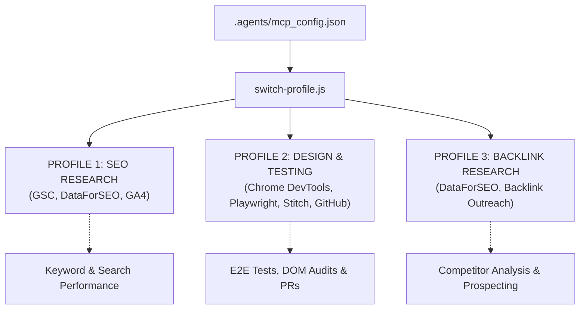

# System & Technical Architecture — AnyConverter

## 1. Directory Structure
```
AnyConverter/
├── .agents/
│   ├── mcp_config.json        # Central MCP server declarations & states
│   ├── switch-profile.ps1     # PowerShell profile switcher
│   ├── scripts/
│   │   └── switch-profile.js  # Node.js MCP profile manager
│   └── skills/                # Antigravity progressive skills
│       ├── seo-audit/
│       └── ui-ux-pro-max/
├── .ai-memory/                # Persistent cross-session agent memory
│   ├── PROJECT.md
│   ├── DESIGN.md
│   ├── ARCHITECTURE.md
│   ├── DECISIONS.md
│   ├── STATE.json
│   └── HANDOFF.md
├── assets/                    # Shared CSS, JS libraries, vendor scripts, icons
├── <tool-directories>/        # Individual static tool pages (each has index.html)
└── AGENTS.md                  # Master agent operating guidelines
```

## 2. MCP Integration Architecture

The Model Context Protocol integration is configured with zero conflicting files using the native `"disabled": true / false` flag recognized by Antigravity CLI and IDE.



## 3. Tool Implementation Specifications
- **Client-Side First:** All utilities execute in the browser using JavaScript, WebAssembly, or Web Workers. No server-side file uploads or processing required.
- **Privacy Assurance:** User files (especially PDFs, images, and sensitive documents) remain local to the user's browser.
- **Progressive Enhancement:** Core calculation and conversion logic works without external CDNs where possible.
