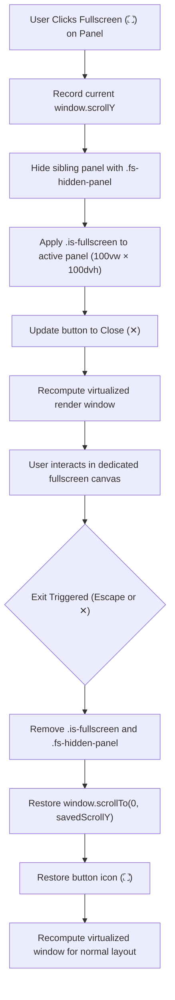

# AnyConverter.io — UI/UX Design System & Standards

## 1. Executive Summary & Design Vision

**AnyConverter.io** is a high-performance, client-side web utility platform providing conversion, calculation, formatting, and document manipulation tools.

The design philosophy is centered on **speed, utility, clarity, and zero-friction execution**. Tools must load instantaneously, execute safely in the user's browser without unnecessary network roundtrips, and provide clean, ergonomic controls that scale effortlessly from a 320px mobile viewport to an ultra-wide 4K workstation.

---

## 2. Core Design Principles

### Principle 1: Clarity Over Decoration
- Every screen must have a clear visual hierarchy where the primary action is instantly recognizable.
- Tools are functional workspaces, not marketing landing pages; UI chrome must never compete with user content.
- Iconography must always be paired with or supplemented by accessible text labels, tooltips, and standard ARIA attributes.

### Principle 2: Strict Consistency
- Spacing, typography, button sizes, border radii, colors, and interactive behaviors are governed by a shared design token architecture.
- Component styling must never be hardcoded with arbitrary one-off pixel values when an existing design token exists.

### Principle 3: Function First & Data Density
- Prioritize content visibility: maximized editor canvases, minimized header heights, and compact toolbars.
- Avoid oversized banners, excessive vertical padding, or decorative illustrations that push core tools below the fold.

### Principle 4: Responsive by Design
- Every layout must gracefully adapt across all standard responsive breakpoints:
  - **Small Mobile:** `320px – 389px` (e.g., iPhone SE)
  - **Standard Mobile:** `390px – 767px` (e.g., iPhone 14/15, Pixel 7)
  - **Tablet:** `768px – 1023px` (e.g., iPad Mini, iPad 10th Gen)
  - **Small Laptop:** `1024px – 1365px`
  - **Standard Laptop / Desktop:** `1366px – 1920px+`
- Content must never overflow horizontally (`overflow-x: hidden` safety with strict `max-width: 100%`).
- Toolbars must wrap logically into compact, balanced secondary rows rather than clipping or spilling offscreen.

### Principle 5: Accessibility (WCAG 2.2 AA Compliance)
- **Contrast:** Minimum 4.5:1 contrast ratio for all normal text and interactive controls; 3:1 for large text and non-text UI elements.
- **Touch Targets:** Minimum 38px to 44px interactive tap target size on mobile and touch devices.
- **Keyboard Navigation:** Full tab-order operability, visible 2px–3px focus rings (`--shadow-focus`), and standard escape routes (`Escape` closes modals and fullscreens).
- **Semantics:** Explicit ARIA roles (`role="search"`, `role="toolbar"`, `aria-live="polite"`), descriptive labels, and screen-reader announcements.

### Principle 6: Zero-Lag Performance & Virtualization
- Interfaces operating on large payloads (up to 100 MB or millions of lines of text) must utilize off-thread Web Workers and windowed DOM virtualization.
- CSS layout changes (such as toggling fullscreen) must never force layout thrashing, DOM re-creation, or re-tokenization.

### Principle 7: Progressive Disclosure
- Display frequently used primary actions directly in the main view.
- Secondary options, formatting switches, and configuration parameters belong in compact dropdowns or dedicated sidebars.

### Principle 8: Multilingual Parity & Internationalization
- UI components must accommodate variable text lengths across English (`en`), Spanish (`es`), and Danish (`da`) without text truncation, layout collisions, or awkward word wraps.

---

## 3. Reusable Design Tokens

### 3.1 Color Palette & Semantic Surfaces

| Token | Light Theme Value | Dark Theme Value | Purpose |
|---|---|---|---|
| `--color-primary` | `#B04A45` | `#C85A54` | Primary brand accent, active toggles, key CTAs |
| `--color-primary-hover` | `#963B37` | `#A94640` | Hover state for primary buttons |
| `--color-primary-light` | `#F3E7E4` | `#3A2421` | Active state badges, subtle brand backgrounds |
| `--color-primary-alt` | `#C28A3D` | `#D29A4C` | Secondary accent, highlight accents |
| `--color-bg` | `#F7F6F3` | `#11100E` | Main page canvas background |
| `--color-surface` | `#FFFFFF` | `#1A1815` | Panel containers, inputs, editor canvas |
| `--color-surface-2` | `#F5F1EE` | `#24211D` | Toolbars, search bars, table headers |
| `--color-border` | `#DDD8D0` | `#403A33` | Standard container and input borders |
| `--color-border-focus` | `#B04A45` | `#C85A54` | Focused input border highlight |
| `--color-border-light` | `#ECE7DF` | `#302B26` | Subtle dividers and button hover borders |
| `--color-text` | `#151515` | `#F7F3ED` | Primary high-contrast text |
| `--color-text-2` | `#3F3A36` | `#D9D1C7` | Secondary text, labels, toolbar icons |
| `--color-text-3` | `#7C7169` | `#A89D92` | Placeholders, muted hints, counter labels |
| `--color-text-body` | `#6F625A` | `#C6BDB3` | Documentation and prose body text |
| `--color-success` | `#059669` | `#86EFAC` | Valid status indicators, success confirmations |
| `--color-success-bg` | `#ECFDF5` | `#052E16` | Success status banner fill |
| `--color-error` | `#DC2626` | `#FCA5A5` | Syntax errors, validation alerts, exit button hover |
| `--color-error-bg` | `#FEF2F2` | `#450A0A` | Error status banner fill, destructive badge fill |

### 3.2 Typography & Sizing Scale

```css
--font-sans: 'Inter', -apple-system, BlinkMacSystemFont, 'Segoe UI', Roboto, sans-serif;
--font-mono: 'JetBrains Mono', 'Fira Code', 'Cascadia Code', 'Consolas', monospace;

--text-xs:   0.75rem;   /* 12px — counters, fine badges, micro labels */
--text-sm:   0.875rem;  /* 14px — buttons, inputs, toolbar controls */
--text-base: 1.000rem;  /* 16px — standard body text */
--text-lg:   1.125rem;  /* 18px — card headings, panel titles */
--text-xl:   1.250rem;  /* 20px — section headers */
--text-2xl:  1.500rem;  /* 24px — secondary tool page titles */
--text-3xl:  1.875rem;  /* 30px — primary tool h1 headers */
```

### 3.3 Spacing & Layout Rhythm

```css
--space-1:  0.25rem;  /* 4px  — micro element gap, button padding */
--space-2:  0.50rem;  /* 8px  — standard control gap, toolbar padding */
--space-3:  0.75rem;  /* 12px — panel inner margin, header padding */
--space-4:  1.00rem;  /* 16px — component outer padding, editor padding */
--space-5:  1.25rem;  /* 20px — container spacing */
--space-6:  1.50rem;  /* 24px — section vertical gap */
--space-8:  2.00rem;  /* 32px — major layout division */
```

### 3.4 Interactive Controls & Touch Standards

| Component | Target Height | Desktop Width | Mobile Width | Border Radius | Focus Ring |
|---|---|---|---|---|---|
| **Compact Search Input** | `36px – 38px` | `240px – 320px` | `100%` (flex) | `6px – 8px` | `0 0 0 3px rgba(176,74,69,0.2)` |
| **Search Scope Dropdown** | `36px – 38px` | `Auto (~120–140px)` | `Auto / Flex` | `6px – 8px` | `0 0 0 3px rgba(176,74,69,0.2)` |
| **Search Nav Buttons** | `36px – 38px` | `36px – 38px` | `36px – 38px` | `6px – 8px` | Native 2px outline |
| **Standard Toolbar Button** | `32px – 36px` | Content-fit (`>48px`) | Content-fit (`>38px`) | `6px – 8px` | Standard button ring |
| **Fullscreen Toggle Button** | `32px – 36px` | `36px – 40px` | `36px` | `6px – 8px` | High-contrast focus |

---

## 4. Component Architectural Standards

### 4.1 Panel-Specific Fullscreen Architecture

Fullscreen mode must strictly follow the **One-Panel Dedicated Viewport Model**:

1. **Dedicated Panel View:** When fullscreen is activated for a specific panel (e.g., Output or Input), **only that panel occupies the viewport**. Sibling panels must be hidden (`display: none !important;`).
2. **Never Force a 50/50 Split:** Forcing a split-view fullscreen splits user focus and degrades editor usable area on laptops and mobile devices.
3. **Viewport Inset & Sizing:** Fullscreen panels must bind to `position: fixed; inset: 0; width: 100vw; height: 100dvh; z-index: 10000;`.
4. **State & Scroll Preservation:**
   - Window vertical scroll (`window.scrollY`) must be captured prior to entering fullscreen and precisely restored on exit.
   - Internal editor scroll offset, selected search matches, and uploaded worker data must remain 100% intact.
5. **Escape Routes:**
   - Fullscreen must provide a prominent, high-contrast close control (`✕ Close`) pinned at the top-right of the panel header.
   - The `Escape` key must immediately exit fullscreen.
   - Clicking the background backdrop (`#fs-overlay`) must safely exit fullscreen.



---

### 4.2 Compact Professional Search Toolbar

The search toolbar must render as a single unified horizontal row on desktop and tablet:

```
[ 🔍 ] [ Search in JSON...        ✕ ] [ Keys + Values ▾ ] [ 1 of 42 ] [ ‹ ] [ › ]
```

#### Anatomical Requirements:
1. **Search Icon:** Clean SVG magnifying glass positioned inside the input wrapper or immediately to its left.
2. **Compact Search Input:** Height `36px–38px`, desktop width `240px–320px`, neutral border, clear typography, and subtle placeholder.
3. **Clear Control (`✕`):** Appears when input contains text. Clicking clears query, resets highlights, and restores default match count.
4. **Search Scope Select:** Compact dropdown (`auto` width, not 100% stretched). Supports `Keys + Values`, `Keys`, `Values`, `Regex`, and `Path`.
5. **Match Counter:** Tabular numerical display (e.g., `1 of 24` or `No matches`), preventing layout jitter as digits change.
6. **Navigation Controls:** `‹` (Prev / `Shift+Enter`) and `›` (Next / `Enter`) buttons with min 36px touch target.
7. **Baseline Alignment:** All controls must align on a single horizontal baseline with identical heights (`38px`).
8. **Responsive Wrapping:** On viewports under `600px`, the toolbar cleanly wraps into two balanced rows without overflow:
   - Row 1: Search input + Clear + Scope dropdown
   - Row 2: Match count badge + Previous match + Next match

---

### 4.3 Panel Header & Action Grouping Hierarchy

Toolbar buttons must be structured into logical semantic groups:

1. **Primary Actions Group (`.ac-group-primary`):** High-frequency conversion/export tasks (e.g., `Copy`, `Download`). Styled with soft primary or distinct border treatment.
2. **Editor Actions Group (`.ac-group-editor`):** Canvas manipulation (e.g., `Collapse All`, `Expand All`, `A−`, `A+`).
3. **Window Actions Group (`.ac-group-window`):** Pinned at the far right via `margin-left: auto`. Contains the fullscreen toggle / exit button (`⛶` / `✕`).

#### Responsive Button Label Collapsing:
To prevent overflow on narrow screens, text labels use responsive helper spans:
```html
<button class="ac-btn" id="btn-collapse-all" title="Collapse all nodes">
  <span class="btn-lbl-full">Collapse all</span>
  <span class="btn-lbl-short">Collapse</span>
</button>
```
- `@media (max-width: 1440px)`: `.btn-lbl-full` is hidden, `.btn-lbl-short` is displayed.
- `@media (max-width: 480px)`: Buttons use compact padding (`padding: 0 6px; font-size: 11px;`).

---

## 5. Accessibility & Quality Checklist

Every new or refactored tool on AnyConverter must pass the following audit checklist:

- [ ] **Single-Panel Fullscreen:** Does fullscreen display exactly one panel at 100% viewport width and height?
- [ ] **Scroll Restoration:** Does the window scroll position return to its exact pre-fullscreen coordinates upon exit?
- [ ] **Escape Route:** Does pressing `Escape` exit fullscreen and close open search overlays?
- [ ] **Touch Target Size:** Are all interactive touch targets at least 36px–44px?
- [ ] **Contrast Compliance:** Do all text elements meet WCAG 2.2 AA 4.5:1 contrast in both light and dark modes?
- [ ] **Zero Viewport Overflow:** Does the layout remain completely free of horizontal scrollbars across all 7 mandated resolutions (`320px`, `390px`, `768px`, `1024px`, `1366px`, `1440px`, `1920px`)?
- [ ] **Multilingual Safety:** Do Danish and Spanish localized strings render cleanly without clipping or overlapping adjacent controls?
- [ ] **Performance Stability:** Does virtualized rendering execute smoothly at 60 FPS without memory leaks during rapid fullscreen toggles?

---

## 6. Permanent Design Quality Rules

Every tool and UI workflow must adhere to these 7 permanent design quality rules:

1. **Never duplicate functionally identical search interfaces in the same visible workspace without a justified reason.**
   - In normal split-panel mode, search controls are located exclusively in the sidebar. The Output panel must not duplicate search inputs, dropdowns, or counters.
   - In fullscreen mode, the compact search toolbar is displayed because sidebars are hidden from view.
2. **Fullscreen utility toolbars must use compact horizontal layouts on desktop.**
   - All controls must align in ONE horizontal row: `[Search JSON...] [Keys + Values ▼] [0 / 0] [Previous] [Next] [Clear]`.
   - Never wrap controls into multiple lines on desktop/laptop viewports (1024px, 1366px, 1440px, 1920px).
3. **Inputs and dropdowns should not expand to full width without functional justification.**
   - Desktop search input width is constrained to 220px–260px.
   - Search scope dropdown width is constrained to 140px–170px.
   - Navigation and action buttons are fixed at 36 × 36px.
   - Global form styles (`select { width: 100% }`) must never override compact toolbar components.
4. **The editor must receive priority over controls and decoration.**
   - Maximize editing and viewing real estate by keeping toolbar height compact (36px controls, 52px total bar height).
5. **Sidebar sections must follow the specified information hierarchy.**
   - The verified standard order of right sidebar sections is:
     1. Advertisement
     2. Search
     3. Options
     4. Bookmarks
     5. Stats
6. **Verify final rendered appearance, not merely CSS class presence.**
   - Tests and visual audits must render in actual browser environments (Playwright headless/headful) rather than relying solely on string or DOM attribute presence.
7. **Test actual component bounding rectangles, computed styles, and visual spacing.**
   - Measure `getBoundingClientRect()` across target viewports and zoom levels (100%, 125%) to verify zero control overlapping, proper horizontal spacing (8px), container padding (8–12px), and shared vertical baselines.
