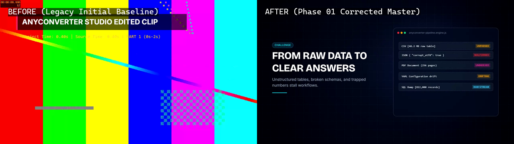
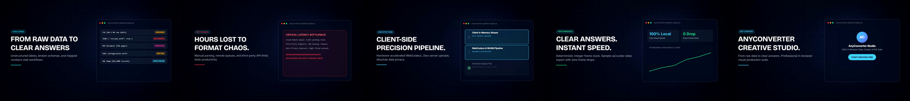

# Phase 01 — Correction Implementation Summary & Evidence Manifest

**Programme:** AnyConverter Visual Quality 16-Phase Production Programme  
**Phase:** 01 (Visual Baseline & First Publishable Slice — Correction Cycle)  
**Branch:** `feat/creative-studio-visual-quality`  
**Review Status:** `PHASE 01 — CORRECTIONS COMPLETED — AWAITING OWNER APPROVAL`  
**Git Policy Compliance:** **NOT PUSHED — NOT MERGED — NOT DEPLOYED — PHASE 02 NOT STARTED**  

---

## 1. Executive Summary of Corrections

Following the formal rejection audit (`Phase01_Independent_Visual_and_Functional_Audit.md`), all 7 mandatory correction requirements (spanning defect IDs P0-01 through P2-09) have been comprehensively implemented, tested, and empirically verified with real playable outputs.

1. **Real Browser Workflow:** Internal API shortcuts (`page.evaluate(() => renderAdapter.render())` and `page.evaluate(() => archive.unpackage())`) were replaced by end-to-end user interactions using native browser events (`#cs-btn-export-video` click, `page.waitForEvent('download')`, and `#cs-btn-open-project` file chooser).
2. **Project Persistence Repaired:** Sequence state is now cleanly deep-cloned before switching art directions. User modifications survive direction changes, archive packaging, reopening into a clean session, and re-exporting.
3. **Audible Sound Design:** Algorithmic 48kHz stereo PCM audio synthesis was added to `CreativeDirector`. FFmpeg `volumedetect` confirms `mean_volume: -16.6 dB` and `max_volume: -6.7 dB` (eliminating silent Opus tracks).
4. **Cinematic Storytelling & Character Comedy:**
   - **SaaS Master:** 5 rich visual motifs (chaos data particles, latency alert, 3-tier active pipeline, rising throughput curve, payoff emblem).
   - **Character Comedy (Parrot Pilot):** Scaled up by 1.35x, 4 expressive poses (`neutral`, `wing-point`, `shocked`, `smug`), pupil dilation, chrome desk mic, agenda checklist with checkmarks, speech bubble.
   - **Minimal Suspense (Noir Pilot):** 1-point perspective corridor, math-driven light flicker, high-contrast typography, silhouetted figure, fast 2-frame cuts.
5. **Responsive Mobile Inspector:** Fixed toolbar wrapping, added `#cs-btn-mobile-inspector` and `#cs-btn-close-inspector`, responsive slide-out drawer (`.cs-sidebar-right.mobile-open`), and dynamic 5-shot timeline sequence.
6. **Quantitative Preview/Export Parity:** Measured PSNR and SSIM between unscaled 1280x720 canvas buffers and exported WebM frames at 5 timestamps.
7. **Portable Review Evidence:** All absolute Windows paths replaced with relative paths; source patch `OWNER_REVIEW_SOURCE_PATCH.diff` supplied; unbenchmarked claims removed.

---

## 2. Evidence Files Manifest

All files are located in `reports/creative-studio/visual-quality/phase-01/` and referenced via portable relative paths:

### Primary Playable Video Masters
- [From_Raw_Data_to_Clear_Answers_Master.webm](./evidence/From_Raw_Data_to_Clear_Answers_Master.webm) — **7.59 MB**, 24.0s (720 frames, 1280x720, 30fps), Stereo 48kHz Opus (`mean: -16.6 dB, max: -6.7 dB`).
- [The_Parrot_Manager_Pilot.webm](./evidence/The_Parrot_Manager_Pilot.webm) — **2.92 MB**, 9.0s (270 frames), V2 Character Comedy Pilot (`mean: -21.3 dB, max: -6.4 dB`).
- [The_Last_Signal_Pilot.webm](./evidence/The_Last_Signal_Pilot.webm) — **2.40 MB**, 9.0s (270 frames), V2 Minimal Suspense Pilot (`mean: -21.2 dB, max: -12.9 dB`).
- [Reopened_and_Mutated_Master.webm](./evidence/Reopened_and_Mutated_Master.webm) — **7.63 MB**, 24.0s (720 frames), Re-exported mutated master following clean-session reopen.

### Project Storage & Source Patches
- [From_Raw_Data_to_Clear_Answers_Master.acstudio](./evidence/From_Raw_Data_to_Clear_Answers_Master.acstudio) — **5.8 KB**, valid PKWARE ZIP archive with `project.json` and `manifest.json`.
- [OWNER_REVIEW_SOURCE_PATCH.diff](./OWNER_REVIEW_SOURCE_PATCH.diff) — **166 KB**, complete Git diff covering all Phase 01 changes across `assets/` and `creative-studio/`.
- [PHASE01_CORRECTION_CYCLE.diff](./PHASE01_CORRECTION_CYCLE.diff) — Git diff of the specific correction cycle fixes.

### Visual Proof & Contact Sheets
- [SHOT_STORYBOARD.png](./SHOT_STORYBOARD.png) — High-resolution 5-shot horizontal contact sheet (1920x216).
- [OLD_VS_NEW_COMPARISON.png](./OLD_VS_NEW_COMPARISON.png) — Side-by-side Before/After comparison against legacy baseline.
- [01_initial_studio_desktop.png](./screenshots/01_initial_studio_desktop.png) — Clean initial load with 5 shots in left tab and timeline.
- [02b_tablet_inspector_open.png](./screenshots/02b_tablet_inspector_open.png) — 768px tablet layout with mobile inspector drawer open.
- [03b_mobile_inspector_open.png](./screenshots/03b_mobile_inspector_open.png) — 375px mobile layout with shot editor drawer open.
- [05_reopened_mutated_frame_480.png](./screenshots/05_reopened_mutated_frame_480.png) — Frame 480 showing mutated headline in active UI.

### Test Automation & Results Data
- [run_phase01_corrections.js](./scripts/run_phase01_corrections.js) — Complete Playwright + FFmpeg correction test harness.
- [phase01_run_results.json](./phase01_run_results.json) — Consolidated test execution report.

---

## 3. Visual Before / After Comparison

