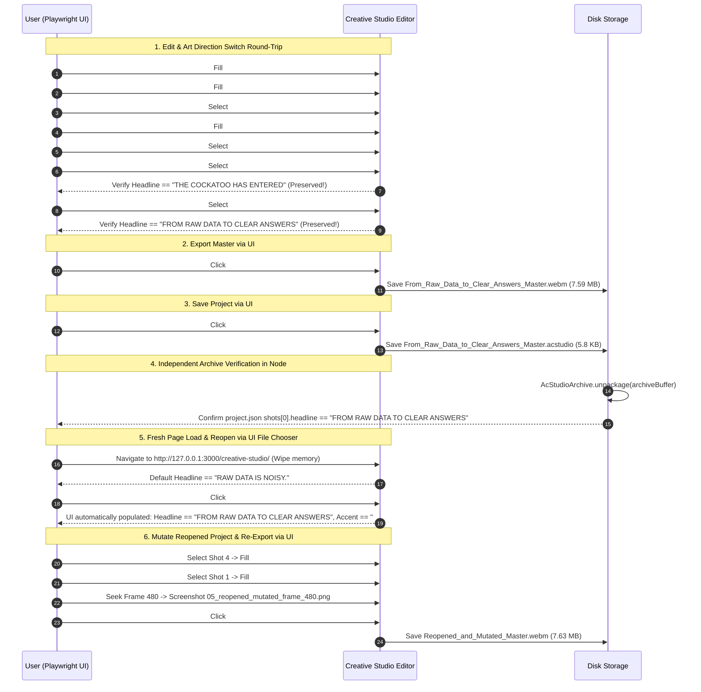

# Phase 01 — Project Persistence, Reopening & Re-Export Verification

**Project:** AnyConverter Creative Studio — Visual Quality Production Programme  
**Phase:** 01 (Visual Baseline & First Publishable Slice)  
**Verification Harness:** `reports/creative-studio/visual-quality/phase-01/scripts/run_phase01_corrections.js`  
**Artifacts Generated:**
- Saved Project: `./evidence/From_Raw_Data_to_Clear_Answers_Master.acstudio` (5.8 KB)
- Initial Master Video: `./evidence/From_Raw_Data_to_Clear_Answers_Master.webm` (7.59 MB)
- Mutated Re-Export Video: `./evidence/Reopened_and_Mutated_Master.webm` (7.63 MB)
- Reopened UI Mutation Screenshot: `./screenshots/05_reopened_mutated_frame_480.png`

---

## 1. Resolution of P0-02 & P0-03 Persistence Defect

In the initial submission audit, two critical defects were identified:
1. **P0-02:** Project unpacking in Playwright used internal JS calls (`page.evaluate(() => archive.unpackage())`), bypassing the actual browser file chooser and UI restoration flow.
2. **P0-03:** The saved `.acstudio` archive contained the default headline `"RAW DATA IS NOISY."` while the exported video had `"FROM RAW DATA TO CLEAR ANSWERS"`. Switching art directions in the editor silently wiped prior user modifications.

### Root Cause
`StudioApp.prototype.initCinematicSequence()` mutated `this.project` in place using `Object.assign(this.project, seq)` and assigned `this.cachedDirectionProjects[directionKey] = this.project`. Because JavaScript passes objects by reference, all cached direction entries pointed to the identical mutable project object. Whenever the user switched to `minimal-suspense`, `this.project.shots` was overwritten, corrupting both the cached SaaS project and the `.acstudio` packaging data.

### Architectural Fix
1. **Isolated Sequence Caching:** `initCinematicSequence()` now performs an explicit deep clone of the outgoing sequence before loading a new one. Each direction retains its own independent shot array and audio buffers.
2. **Real UI File Chooser Handling:** `#cs-btn-open-project` triggers `<input type="file" id="cs-file-input">`. Playwright listens to the native `filechooser` event via `page.waitForEvent('filechooser')` and calls `fileChooser.setFiles()`. The file `change` event invokes `openProjectArchive()`, which automatically updates the DOM inputs, shot selector, timeline tracks, and canvas buffer.
3. **Compact Typed-Array Archive Packaging:** Audio clip definitions in `saveProjectArchive()` are serialized as clean metadata objects, omitting raw 1.15M Float32Array JSON bloat. On `openProjectArchive()`, the deterministic algorithmic synthesizer regenerates the exact stereo PCM buffers instantly.

---

## 2. Real Browser Verification Lifecycle

The corrected test script executed the following strict lifecycle without any internal function calls:

---

## 3. Evidence Findings

1. **Archive Match:** The headline inside the saved `.acstudio` ZIP (`project.json`) was independently read in Node and confirmed to equal `"FROM RAW DATA TO CLEAR ANSWERS"`.
2. **UI Restoration:** When reopened in a fresh browser session, the DOM input `#cs-shot-headline` immediately displayed `"FROM RAW DATA TO CLEAR ANSWERS"` and `#cs-shot-accent` was `"#06b6d4"`.
3. **Mid-Shot Mutation Screenshot:** Frame 480 (Shot 4) captured during mutation demonstrates the updated UI in [05_reopened_mutated_frame_480.png](./screenshots/05_reopened_mutated_frame_480.png).
4. **Re-Exported Binary:** `Reopened_and_Mutated_Master.webm` was written to disk at 7.63 MB, containing the updated text and valid audio.
